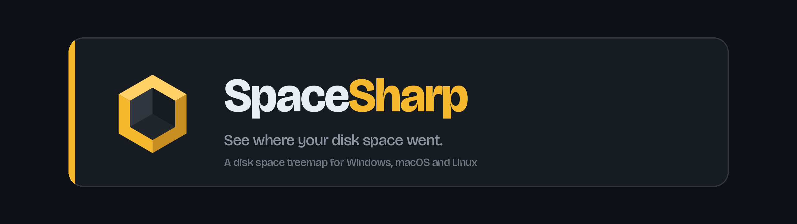

  

  <b>SpaceSharp is a free, open source disk space analyzer for Windows.</b> 
  Your drive as a zoomable treemap: scan in seconds, filter in plain words, see what changed, clean up from the map.

  
  
  

  <a href="https://github.com/SpaceSharpApp/SpaceSharp">Source on GitHub</a> · MIT license · Windows 10 and 11 · 18 languages · No telemetry

  
   
  Every file and folder is a box sized by the space it uses. Sample data.

## What it does

Your drive is full and you do not know why. SpaceSharp reads it in seconds and draws it as one picture: folders are frames, files are boxes inside them, and the biggest boxes are where the space went. From there:

- **Scan a terabyte in seconds.** The NTFS file table is read directly, and the map draws while the scan runs.
- **Zoom** into any folder, and back out with one key.
- **Filter in plain words.** `videos over 1GB older than a year` dims everything else and keeps the map. A drawer writes the same filter from tiles and scales.
- **Find what is safe to clear.** Insights lists the usual suspects with the space they hold, and finds empty folders and duplicate files.
- **Read the scan as a report.** Statistics lays out the files by size, kind and age, and every figure opens the map filtered to it.
- **See what changed.** Every scan is saved, and Changes lays two of them side by side, folder by folder.
- **Clean up without surprises.** Everything goes to the Recycle Bin by default, and anything touching Windows, program or app folders always asks first.
- **Export a table.** Any folder, the largest files, the filter's matches or the changes, as CSV or TSV.

## Get it

For Windows 10 and 11, 64-bit or 32-bit, from the [latest release](https://github.com/SpaceSharpApp/SpaceSharp/releases/latest): a portable exe, a one-click installer that updates itself, or an MSI. Every download is code-signed.

No telemetry, no account, and no network use beyond the update check and What's new, which you can switch off. The app is built on Avalonia; the macOS and Linux packages are not published yet, but it builds and runs there from source.

## Where things are

| | |
|---|---|
| [**SpaceSharp**](https://github.com/SpaceSharpApp/SpaceSharp) | The app: source, [releases](https://github.com/SpaceSharpApp/SpaceSharp/releases), [changelog](https://github.com/SpaceSharpApp/SpaceSharp/blob/main/CHANGELOG.md), [issues](https://github.com/SpaceSharpApp/SpaceSharp/issues) |
| [spacesharp.app](https://spacesharp.app/) | The website: what it does, screenshots, downloads and how it compares |
| [docs.spacesharp.app](https://docs.spacesharp.app/) | The manual: getting started, the filter language, every setting and shortcut |
| [CONTRIBUTING](https://github.com/SpaceSharpApp/SpaceSharp/blob/main/CONTRIBUTING.md) · [DEVELOPING](https://github.com/SpaceSharpApp/SpaceSharp/blob/main/DEVELOPING.md) | How to report a bug, send a change, and build the app |
| [SECURITY](https://github.com/SpaceSharpApp/SpaceSharp/blob/main/SECURITY.md) | What the app reads, writes and deletes, and how to report a vulnerability |

## Get involved

Bug reports and ideas go to [issues](https://github.com/SpaceSharpApp/SpaceSharp/issues); a screenshot and the Windows version help. Pull requests are welcome for fixes, translations and features that fit; CONTRIBUTING says what to expect. The interface is in 18 languages: English and Norwegian are written by hand, and the other sixteen are machine translations that would be glad of a native speaker. A star on the repository is the easiest way to help people find it.

SpaceSharp is made by [ClearanceClarence](https://github.com/ClearanceClarence) and released under the MIT License.
